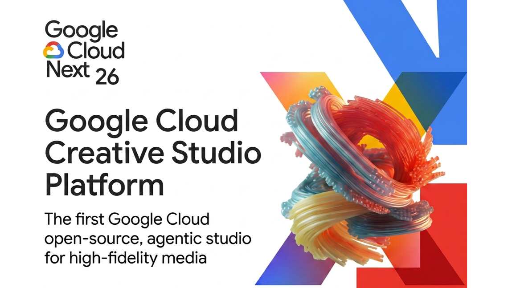
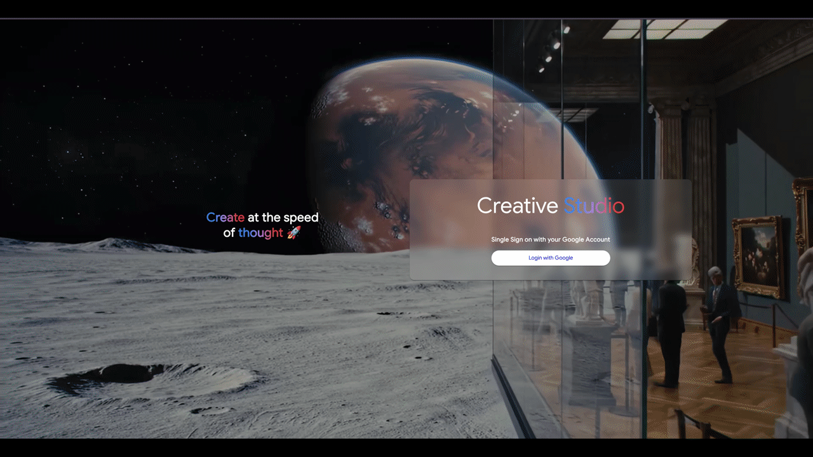

<div align="center">
  
  <br>
  <br>
  <h1 align="center">Google Cloud Creative Studio Platform</h1>
  <p align="center"><b>The First Google Cloud Open Source, All-in-One Agentic Studio <br> for Building High-Fidelity Multimedia Content 🚀</b></p>

  <p align="center">
    
    
    
    
    <a href="https://github.com/pylint-dev/pylint"></a>
    <a href="https://github.com/google/gts"></a>
    
  </p>

</div>

---

**Creative Studio** is METRO Digital's enterprise deployment of Google Cloud's generative AI platform, enhanced with workspace collaboration, team management, and private workspace per user. Built on FastAPI + Angular, deployed on Cloud Run with infrastructure-as-code.

## 🎯 METRO Customizations

Unlike the upstream Google project, this fork adds:

---

## ☁️ Google Cloud Next '26 & Izumi Integration

We are super excited to announce that we will be at **Google Cloud Next '26**! Our team will be attending and showcasing our deep integration with the **Izumi Agent**. 

Learn more about the multi-agent multimedia ecosystem at the [Izumi Agent Repository](https://github.com/GoogleCloudPlatform/genmedia-izumi-agent/tree/main).

---

## Core Features 🎨

## 📖 Quick Start

### Option A: Deploy to Cloud Run (METRO 3-Env Setup)

Follow [CLOUD_SETUP.md](CLOUD_SETUP.md) for step-by-step deployment to:
- **Dev** (develop branch) → cf-genaistudi-genai-studio--gv
- **Pre-Production** (test branch) → cf-genaistudi-genai-studio--vm
- **Production** (main branch) → cf-genaistudi-genai-studio--7u

**Key requirement:** Organization IAM policy compliance (no primitive roles, Workload Identity Federation only).

### Option B: Local Development with Docker

For local development and testing:

```bash
# Prerequisites: Docker, Docker Compose, Python 3.11+, Node.js 18+

# 1. Clone and setup environment
git clone https://github.com/metro-digital-inner-source/gcc-creative-studio.git
cd gcc-creative-studio
cp .env.example .env  # Configure for local testing

- Upload PDF style guides that the backend processes to automatically infuse brand identity into generated content.
- Features a robust, scalable upload mechanism using GCS Signed URLs to bypass server timeouts and handle large files efficiently..

**👕 Virtual Try-On (VTO):**

- Includes functionality for seeding system-level assets like garments and models, laying the groundwork for virtual try-on applications.

## GenMedia Screenshots | Creative Studio

<p align="center">
  
</p>


## Deploy in 20min!!

Just run this script which has a step by step approach for you to deploy the infrastructure and start the app, just follow the instructions

```
curl https://raw.githubusercontent.com/GoogleCloudPlatform/gcc-creative-studio/refs/heads/main/bootstrap.sh | bash
```

**Note:** Local Docker uses Firebase Admin SDK for auth. Cloud Run uses Google Identity Platform OIDC.
See [DEVELOPMENT.md](DEVELOPMENT.md) for full local setup details.

## 🏗️ Architecture Overview

```
┌──────────────────────────────────────────────┐
│  METRO Users (@metro.digital/@metro-gsc.in)  │
└──────────────────┬───────────────────────────┘
                   │
         ┌─────────▼──────────┐
         │ IAP + Email Check  │
         └─────────┬──────────┘
                   │
          ┌────────┴────────┐
          │                 │
    ┌─────▼─────┐    ┌─────▼──────┐
    │ Frontend  │    │  Backend   │
    │ Cloud Run │◄──►│  Cloud Run │
    │   (SSR)   │    │ (FastAPI)  │
    └─────┬─────┘    └─────┬──────┘
          │                │
          │      ┌─────────▼────────┐
          │      │   Cloud SQL      │
          │      │  PostgreSQL      │
          │      │ (user, group, ws)│
          │      └──────────────────┘
          │
          ├─► GCS (Brand Guidelines, Media)
          ├─► Secret Manager (API keys)
          └─► Vertex AI (Gemini, Imagen, Veo)
```

**Load Balancer + IAP** sits in front, enforcing email domain (`@metro.digital` / `@metro-gsc.in`) before traffic reaches Cloud Run.

## 📚 Documentation

| Document | Purpose |
|----------|---------|
| [CLOUD_SETUP.md](CLOUD_SETUP.md) | **Start here:** 3-env deployment, Terraform, GitHub Actions CI/CD |
| [DEVELOPMENT.md](DEVELOPMENT.md) | Local Docker development, testing, debugging |
| [DEPLOYMENT_SETUP.md](DEPLOYMENT_SETUP.md) | Additional deployment configuration details |
| [DEPLOYMENT_REQUIRED_PERMISSIONS.md](DEPLOYMENT_REQUIRED_PERMISSIONS.md) | IAM roles required for deployment |
| [docs/](docs/) | METRO-specific guides (customizations, troubleshooting, WIF setup) |
| [SECURITY.md](SECURITY.md) | Security policies and incident response |
| [CONTRIBUTING.md](CONTRIBUTING.md) | Development guidelines and PR process |

## 🎨 Core Features

**🎬 Video Generation (Veo)**
- Generate videos from text or reference images
- ASSET consistency (reuse objects) or STYLE transfer modes

**🖼️ Image Generation (Imagen)**
- Text-to-image with advanced controls
- Integration with brand guidelines (PDF → automatic style transfer)

**✍️ Gemini Multimodal**
- Prompt rewriting for better generation results
- Multimodal critic (feedback on generated images)

**👥 Team Collaboration**
- Groups (e.g., "AI Enabler") with shared resources
- Private workspace per user (isolated projects)
- Admin dashboard for user/group management

## 🔐 Authentication & Authorization

- **Local Docker:** Firebase Admin SDK (development only)
- **Cloud Run:** Google Identity Platform OIDC
- **Access Control:** IAP email domain enforcement + RBAC per group
- **WIF:** No service account keys (GitHub Actions → Workload Identity Federation)

| Category           | Technology / Service                                     |
| :----------------- | :------------------------------------------------------- |
| **Frontend**       | Angular, TypeScript, Angular Material, Tailwind CSS      |
| **Backend**        | Python, FastAPI, Pydantic                                |
| **Database**       | Google Cloud SQL (PostgreSQL)                            |
| **Cloud Provider** | Google Cloud Platform (GCP)                              |
| **Deployment**     | Cloud Run (frontend + backend), Identity-Aware Proxy (IAP) for login |
| **AI Models**      | Imagen, Veo, Gemini (via Vertex AI SDK)                  |

| Layer | Technology |
|-------|-----------|
| **Frontend** | Angular 18, TypeScript, Angular Material, Tailwind CSS |
| **Backend** | Python 3.11+, FastAPI, Pydantic, SQLAlchemy |
| **Database** | PostgreSQL (Cloud SQL on GCP, local postgres in Docker) |
| **Infrastructure** | Google Cloud Run, Cloud SQL, Artifact Registry, Secret Manager |
| **IaC** | Terraform (3-environment configuration) |
| **CI/CD** | GitHub Actions (WIF-based, no keys) + Cloud Build |
| **AI Models** | Vertex AI (Gemini, Imagen, Veo) |

## 🚀 Deployment Status

- ✅ Dev environment (develop branch) — actively deployed
- ✅ Pre-Production environment (test branch) — for final validation
- ✅ Production environment (main branch) — for end-users
- ✅ All 362 backend tests passing
- ✅ Frontend builds successfully (Angular 18)

## 📞 Support & Escalation

For issues, see [docs/TROUBLESHOOTING.md](docs/TROUBLESHOOTING.md).

For urgent production incidents:
- **Backend/API issues:** Check Cloud Run logs via `gcloud run services describe`
- **Database issues:** Cloud SQL logs + connection troubleshooting
- **Deployment issues:** Check GitHub Actions workflow + Cloud Build logs

## 📝 License & Attribution

Licensed under [LICENSE](LICENSE). Based on [Google Cloud Creative Studio](https://github.com/GoogleCloudPlatform/gcc-creative-studio) with METRO Digital enhancements for enterprise team collaboration.

---

- `aiplatform.googleapis.com` (Vertex AI)
- `artifactregistry.googleapis.com` (Artifact Registry)
- `cloudbuild.googleapis.com` (Cloud Build)
- `cloudfunctions.googleapis.com` (Cloud Functions)
- `compute.googleapis.com` (Compute Engine)
- `sqladmin.googleapis.com` (Cloud SQL)
- `iamcredentials.googleapis.com` (IAM Service API)
- `iap.googleapis.com` (Cloud Identity-Aware Proxy)
- `identitytoolkit.googleapis.com` (Identity Platform)
- `run.googleapis.com` (Cloud Run)
- `secretmanager.googleapis.com` (Secret Manager)
- `texttospeech.googleapis.com` (Text to Speech)

For the deployment you can use CloudShell which already has all of the necessary, but in case of deploying from a computer, the script will automatically check for the following command-line tools and attempt to install them if they are missing or outdated.

- `gcloud` (Google Cloud SDK)
- `git`
- `jq` (JSON processor)
- `uv` (Python package installer)
- `terraform` (version 1.13.0 or newer)

## 🛡️ Quality Standards & CI/CD

To ensure the highest level of quality and security, we enforce strict style guidelines and automated checks both locally and in our CI/CD pipeline.

### 🎨 Code Style Guidelines
- **Python**: We adhere to the [Google Python Style Guide](https://google.github.io/styleguide/pyguide.html), using `pylint` and `black`.
- **TypeScript**: We follow the [Angular Coding Style Guide](https://angular.dev/style-guide) and [Google's TypeScript Style Guide](https://github.com/google/gts) using `gts`.
- **Commit Messages**: We suggest following [Angular's Commit Message Guidelines](https://github.com/angular/angular/blob/main/contributing-docs/commit-message-guidelines.md).

### 🌿 Branching Model
We follow the [Git Flow](https://nvie.com/posts/a-successful-git-branching-model/) branching model. Please create feature branches from `dev` and submit pull requests back to `dev`.

### ⚙️ Automated Checks (Pre-commit & GitHub Actions)

Every Pull Request to `develop`, `test`, or `main` branches undergoes automated checks via GitHub Actions, and you can also run them locally:

- **Local Pre-commit Hook**: Runs in a Docker container on every commit to check styling and licenses. See the [Development Guide](./DEVELOPMENT.md#5-code-quality--pre-commit-hooks) for setup instructions.
- **Backend Tests**: Minimum **80%** code coverage enforced by `pytest-cov`.
- **Backend Linting**: Minimum score of **9.0/10** enforced by `pylint`.
- **Frontend Linting**: Enforced by `gts` in CI.
- **AI-Powered Review**: Automated reviews powered by Gemini to catch issues early.

## 🛠️ Contributing

We welcome contributions to Creative Studio! Whether it's new templates, features, bug fixes, or documentation improvements, your help is valued.

### Prerequisites for Contributing

- A **GitHub Account**.
- **2-Factor Authentication (2FA)** enabled on your GitHub account.
- Familiarity with the "Getting Started" section to set up your development environment.

For more detailed contribution guidelines, please refer to the `CONTRIBUTING.md` file.

### Local Development

For a comprehensive, step-by-step guide on how to set up and run Creative Studio on your local machine using Docker Compose, please refer to the [Local Development Guide](./DEVELOPMENT.md).

## Feedback

- **Found an issue or have a suggestion?** Please [raise an issue](https://github.com/GoogleCloudPlatform/gcc-creative-studio/issues) on our GitHub repository.
- **Share your experience!** We'd love to hear about how you're using Creative Studio or any success stories. Feel free to reach out to us at genmedia-creativestudio@google.com or discuss in the GitHub discussions.

# Relevant Terms of Service

[Google Cloud Platform TOS](https://cloud.google.com/terms)

[Google Cloud Privacy Notice](https://cloud.google.com/terms/cloud-privacy-notice)

# Responsible Use

Building and deploying generative AI agents requires a commitment to responsible development practices. Creative Studio provides to you the tools to build agents, but you must also provide the commitment to ethical and fair use of these agents. We encourage you to:

- **Start with a Risk Assessment:** Before deploying your agent, identify potential risks related to bias, privacy, safety, and accuracy.
- **Implement Monitoring and Evaluation:** Continuously monitor your agent's performance and gather user feedback.
- **Iterate and Improve:** Use monitoring data and user feedback to identify areas for improvement and update your agent's prompts and configuration.
- **Stay Informed:** The field of AI ethics is constantly evolving. Stay up-to-date on best practices and emerging guidelines.
- **Document Your Process:** Maintain detailed records of your development process, including data sources, models, configurations, and mitigation strategies.

# Disclaimer

**This is not an officially supported Google product.**

Copyright 2025 Google LLC. All Rights Reserved.

Licensed under the Apache License, Version 2.0 (the "License");
you may not use this file except in compliance with the License.
You may obtain a copy of the License at

http://www.apache.org/licenses/LICENSE-2.0

Unless required by applicable law or agreed to in writing, software
distributed under the License is distributed on an "AS IS" BASIS,
WITHOUT WARRANTIES OR CONDITIONS OF ANY KIND, either express or implied.
See the License for the specific language governing permissions and
limitations under the License.
